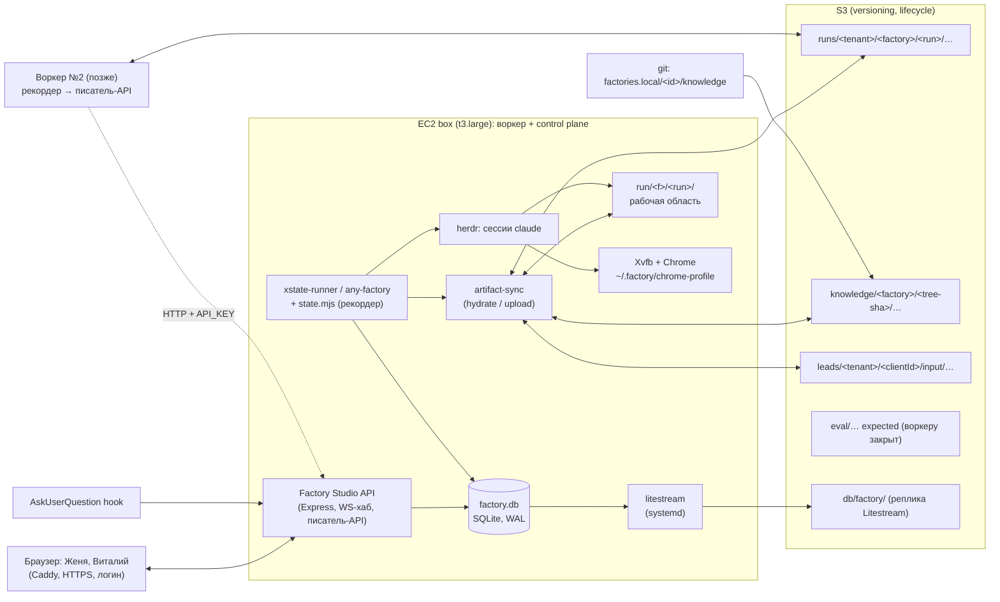

# Хранилище фабрики: БД и объектное хранилище

Дата: 2026-11-03. Основа: код `factories-tools/` (pipeline-state, xstate-runner, factory-studio, ai-usage), `factories.local/klevrs-kp-prod-factory/`, папки `run/`, `deploy/`.

## Коротко

Сегодня вся правда фабрики — файлы на одном диске: `run/<factory>/<run>/state.json`, артефакты шагов, знания в `factories.local`, вопросы в `/tmp/factory-studio/questions`, расходы в `~/.ai-usage`. Это работает на одном боксе и ломается при втором воркере, при `down.sh` и при любом запросе «покажи все прогоны по клиенту X за октябрь».

**Рекомендация:** SQLite + Litestream → S3 как база, S3 как хранилище артефактов, файлы на диске остаются рабочей областью агентов. Один писатель — библиотека `factory-store` на боксе (её зовут рекордер `state.mjs`, Studio и `ai-usage`). Знания — в git плюс снимок дерева с хешем на каждый прогон. Вырастаем до нескольких боксов через «писатель-API» в Studio, а не через смену БД; Postgres на отдельной `t4g.small` — запасной выход, схема переносится как есть. Стоимость: ≈ $1–3/мес сейчас, ≈ $15–40/мес при сотнях прогонов в день (без LLM и EC2).

## 1. Что есть сейчас

Факты из кода, не из описания.

| Данные | Где лежит | Кто пишет | Кто читает | Проблема |
|---|---|---|---|---|
| Состояние прогона | `run/<f>/<run>/state.json` (≈32 КБ, 55 событий, 15 шагов) | `state.mjs`, temp+rename | Studio (inotify на каждую папку), ai-usage | Нет индекса; Studio обходит `run/` на каждый GET |
| События | `history[]` внутри `state.json`; `events.jsonl`, `snapshot.json` у xstate-runner | рекордер | Studio | Нет SQL, нет сквозной ленты по всем прогонам |
| Артефакты шагов | папки `1-get-lead/…8-finalize-kp/`, ≈50 файлов, 9–18 МБ на прогон; 62 % байт — PNG (аудит 2,8 МБ, `site-full.png` 5 МБ) | агенты | агенты следующего шага, Studio (E7, E17 site, E18 zip) | Живут только на боксе; `down.sh` стирает |
| Снимок графа | `run/…/pipeline.json` (hooks.before) | раннер | рекордер, Studio | Есть, но хеш нигде не записан |
| Знания | `factories.local/<id>/knowledge/*.md` | люди через Studio (E16, ETag/If-Match), rsync `box sync`/`pull-knowledge` по mtime | агенты, Studio | Прод-фабрика **не в git**; версий нет; конфликт решается отказом rsync |
| Лид-паки | `data_sql_leads/<clientId>/input/*` (≈130 КБ на пак, `expected/` закрыт) | ручной скрипт | `get-lead`, evals | gitignored, едут только по имени `box sync <pack>` |
| Расходы | `~/.ai-usage/*` (события, курсоры) → `run/…/cost.json` (`hooks.after`) | ai-usage | Studio | Привязка к машине; на боксе и ноутбуке разные копии |
| Вопросы и ответы | `<PROMPT_DIR>/questions/<promptId>.json` (журнал), `decision.md` в шаге | Studio API через hook | Studio, хук (long-poll) | `/tmp` на боксе; после `down.sh` пропадает |
| Параметры | `state.context.params`, `cost.json.params` | рекордер | Studio | Только внутри файла прогона |
| Кросс-прогонные данные | `factories-data/<id>/` (companies.json, improvements/) | агенты, раннер | агенты | Один JSON на всех, без блокировок |
| Сессии | herdr `factory-studio`, транскрипты `~/.claude/projects/...jsonl`, Chrome `~/.factory/chrome-profile` | Claude Code, Chrome | Studio (chat, questions), ai-usage | Всё на одном боксе |

Объёмы: 7 прод-прогонов = 109 МБ; один прогон ≈ 15 МБ; цена прогона по list price $4–170 (с кешем). Хранение — шум на фоне LLM.

## 2. Что хранить где

Правило: **метаданные и события — в БД, байты — в S3, рабочая копия — на диске воркера**. Агент видит только диск.

| Сущность | БД (SQLite) | S3 | Диск воркера |
|---|---|---|---|
| Прогон (id, фабрика, тенант, параметры, статус, версии) | `runs` | — | `state.json` как проекция |
| События и история | `run_events` (append-only) | — | `state.history`, `events.jsonl` как проекция |
| Проходы шагов | `step_passes` | — | `state.steps` |
| Артефакты (md, json, html, png, mp3) | `artifacts`: путь, sha256, размер, тип, ключ S3 | `runs/<tenant>/<factory>/<run>/<путь как на диске>` + versioning | `run/<f>/<run>/…` |
| Снимок `pipeline.json` | `runs.pipeline_sha` | `pipelines/<factory>/<sha>.json` | `run/…/pipeline.json` |
| Знания с версиями | `knowledge_versions` (хеш дерева, файлы, автор) | `knowledge/<factory>/<tree-sha>/…` (content-addressed) | `factories.local/<id>/knowledge` (git checkout) |
| Лид-карты и транскрипты | `leads` (tenant, clientId, источник, статус) | `leads/<tenant>/<clientId>/input/…`; `eval/<tenant>/<clientId>/expected/…` в другом префиксе | `data_sql_leads/<clientId>/input` |
| Расходы | `step_costs` (токены, USD, модель, атрибуция) | `runs/…/cost.json` сырой | `cost.json` |
| Вопросы и одобрения | `questions`, `decisions` | — | `decision.md` в шаге (его пишет раннер по записи в БД) |
| Параметры | `runs.params_json` | — | — |
| История прогонов | `runs` + `run_events` | — | — |
| Очередь и аренда | `jobs`, `workers` | — | — |
| Тенанты, пользователи | `tenants`, `users` | — | — |

Что **не** идёт в БД: тексты артефактов, транскрипты Claude (остаются в `~/.claude/projects`, в S3 — только по запросу evals), секреты.

## 3. Варианты БД

Отброшено одной строкой: RDS, Aurora Serverless v2, Neon/Supabase на платных планах — $15–90/мес фиксированно за объём, который помещается в 100 МБ; EFS как общая рабочая область — $0,30/ГБ (13× S3), миллисекунды на каждый `Read`/`Write` агента, Chrome-профиль на NFS ломается.

### 3.1 Три кандидата

| | **A. SQLite + Litestream → S3** (цель) | B. Postgres на боксе (Docker) + WAL-G/pg_dump → S3 + снимок EBS | C. DynamoDB on-demand + S3 |
|---|---|---|---|
| Где живёт | файл на боксе, реплика в S3 | контейнер на боксе, данные на EBS | AWS |
| Запросы Studio (списки, фильтры, отчёты по стоимости, evals) | полный SQL, оконные функции, JSON1 | полный SQL | только по ключу и GSI; отчёты — через экспорт или Athena |
| Писатели | процессы одного бокса, по очереди (WAL) | много соединений, с любого хоста | любой хост |
| Live для Studio | poll `PRAGMA data_version` каждые 250 мс | `LISTEN/NOTIFY` | Streams → Lambda → свой WS-хаб (3 детали вместо 1) |
| Бокс остановлен (`stop.sh`) | файл на EBS цел; реплика в S3 актуальна на последний sync | данные на EBS целы; WAL-G до последнего архива | данные доступны, но читать их некому: Studio на боксе |
| Бокс уничтожен (`down.sh`) | `litestream restore` ≤ 1 мин | `wal-g backup-fetch` + replay, 5–15 мин | ничего не теряется |
| RAM на t3.large | ≈ 0 (кеш страниц в процессе Studio, ≤ 64 МБ) | 300–500 МБ (`shared_buffers` 256 МБ + соединения) рядом с Chrome 1–1,5 ГБ и 1–4 сессиями `claude` по 300–600 МБ | 0 |
| Несколько воркеров | нет напрямую; через писатель-API Studio (§6) | да, открыть порт в SG | да |
| Нагрузка на одного разработчика | один systemd-юнит, один YAML; бэкап проверяется одной командой | образ, тюнинг, vacuum, WAL-G, обновления мажорных версий | IAM, модель ключей, Streams, нет локальной отладки |
| Lock-in | нет (файл, стандартный SQL) | нет | высокий (схема под ключи, Streams, условные записи) |
| Цена сверх S3 | $0,2–2/мес (PUT реплики) | $1–3/мес (EBS +10 ГБ, снимки) | $1–20/мес |

### 3.2 Цена в месяц, три уровня нагрузки

Допущения: прогон 15 МБ и ≈300 записей в БД; S3 Standard us-east-1 $0,023/ГБ, PUT $0,005/1k, GET $0,0004/1k; lifecycle: через 30 дней в Standard-IA ($0,0125), через 180 — Glacier IR ($0,004); DynamoDB on-demand $0,625/млн WRU, $0,125/млн RRU; EBS gp3 $0,08/ГБ, снимок $0,05/ГБ; Litestream sync 10 с (≈260k PUT/мес). Без EC2 и без LLM.

| Уровень | S3 артефакты, год накопления | A. SQLite+Litestream | B. Postgres на боксе | C. DynamoDB |
|---|---|---|---|---|
| **L1** 10 прогонов/день, 1 тенант (55 ГБ/год) | $0,7–1,3 + запросы $0,2 | +$1,3 (реплика) ≈ **$2–3** | +$1,5 (EBS, снимки) ≈ **$2,5–3** | +$1 ≈ **$2–3** |
| **L2** 100/день, 3 тенанта (550 ГБ/год) | $7–13 + запросы $1,5 | +$1,5 ≈ **$10–16** | +$2,5 ≈ **$11–17** | +$3–5 ≈ **$12–20** |
| **L3** 500/день, 5 тенантов (2,7 ТБ/год) | $35–63 + запросы $7 | +$2 ≈ **$45–72** | +$4 ≈ **$46–74** | +$10–20 ≈ **$55–90** |

На L3 один t3.large не справится (прогон 30 мин, 2 vCPU, Chrome): нужны 5–10 воркеров по ≈ $60/мес каждый, и это важнее любой строки выше. При L3 база так или иначе уезжает с воркера (§3.5).

### 3.3 Почему A

- Наша нагрузка — единицы записей в секунду даже на L3. SQLite в WAL выдерживает тысячи.
- Studio уже один процесс на боксе; добавить ему файл проще, чем сервер.
- Бэкап и восстановление — две команды, проверяются за минуту.
- Схема — обычный SQL; при переезде в Postgres меняется драйвер, не модель.
- Нет новой платёжной строки и нет нового сервиса, за которым надо следить.

### 3.4 Что происходит с боксом

| Событие | Сегодня | С A |
|---|---|---|
| `stop.sh` / `up.sh` | `run/` цел, сессии herdr убиты, вопросы в `/tmp` живы до ребута `/tmp` | БД на EBS цела; Litestream досинхронизирует хвост при старте; очередь `jobs` знает, какие прогоны были `RUNNING` → помечает `INTERRUPTED`, их можно `resume` |
| `down.sh` + `up.sh` | `run/` **пропал**, если не `pull-runs` | `bootstrap.sh`: `litestream restore` → Studio стартует с полной базой; артефакты в S3; `run/` подтягивается по требованию (§5) |
| Пауза на день-два ради одобрения | Studio недоступен, ответить нельзя | то же самое, пока Studio на боксе; выход — §3.5 |
| Диск заполнился | всё стоит | `run/` — кеш: папки `COMPLETED` старше N дней удаляются, байты в S3 |

### 3.5 Где SQLite перестаёт хватать и что тогда

Предел один — **один файл на одном хосте**. Не скорость, не объём (десятки ГБ — норма).

| Триггер | Что делать | Цена |
|---|---|---|
| Второй воркер-бокс | **Писатель-API**: воркер не открывает файл, его рекордер ходит в `POST /api/v1/store/*` Studio (ключ `API_KEY`, уже есть). Studio остаётся единственным писателем. Код рекордера: `--store file:` → `--store http:` | $0, 2–3 дня |
| Нужно одобрять шаги, пока воркер остановлен | Studio + SQLite + Litestream на отдельную `t4g.micro`/`t4g.small` (всегда включена); воркеры — stateless, через писатель-API | $6–14/мес |
| > 3–5 воркеров, или десятки людей в Studio, или хочется `LISTEN/NOTIFY` вместо poll | Postgres на той же маленькой инстанции (apt, 1 ГБ RAM хватает) или контейнер; данные переливаются скриптом по той же схеме | $14/мес, 2–3 дня |
| Аналитика по всем прогонам за год | не трогать БД: `artifacts`/`step_costs` в Parquet в S3 + Athena/DuckDB | центы |

Что делает SQLite непригодным сразу: писать в файл по NFS/EFS с двух хостов (порча), два процесса Litestream на одну базу, принудительный `wal_checkpoint(TRUNCATE)` из приложения (ломает реплику).

## 4. Целевая архитектура



Принципы:

1. **Агент видит только диск.** Контракт шага не меняется: прочитал `input`, записал `output`, вернул событие. Ни один промпт не знает про S3 и БД.
2. **Один писатель БД — бокс Studio.** Все записи идут через библиотеку `factory-store` (better-sqlite3, WAL, `busy_timeout=5000`, `synchronous=NORMAL`). Её зовут три процесса на том же боксе: Studio API, `state.mjs`, `ai-usage`. SQLite сериализует их сам. Чужой хост — только через писатель-API Studio.
3. **S3 — правда для байтов, БД — правда для фактов, диск — кеш.** Любую папку `run/…` можно стереть и собрать обратно из `artifacts` + S3.
4. **Проекции остаются.** `state.json`, `cost.json`, `decision.md` пишутся как раньше — из БД. Всё, что их читает (Studio-web, ai-usage, скиллы), продолжает работать.

## 5. Граница «рабочая область агента ↔ хранилище»

### 5.1 Кто

Раннер, не агент. В xstate-runner — две точки: `step.machine` `preparing` (hydrate) и `collectingOutputs` (upload) — они уже есть, туда добавляется вызов `artifact-sync`. В any-factory (LLM-оркестратор) — те же команды в `runner.md` до `start-step` и после `step-done`; это менее надёжно, поэтому прод переводится на xstate-runner до этапа 4 (§9) — roadmap и так этого хочет.

### 5.2 Hydrate перед шагом

```
artifact-sync hydrate <runDir> --step <step>
  1. runs.pipeline_sha      → run/…/pipeline.json, если нет
  2. knowledge_version      → factories.local/<id>/knowledge/ сверяется с деревом (sha по файлам);
                              отличается → выкачать knowledge/<factory>/<tree-sha>/ в <runDir>/.knowledge/<sha>/
                              и подставить этот путь вместо {{knowledgePath}} (шаг видит ровно ту версию, что записана в прогоне)
  3. input-глобы шага       → по таблице artifacts: нет файла локально или sha не совпал → GET из S3
  4. лид-пак                → leads/<tenant>/<clientId>/input → data_sql_leads/<clientId>/input, если нет
```

Идемпотентно: сравнение по sha256, повторный вызов ничего не качает. Папка `expected/` никогда не гидрируется: у роли воркера нет `s3:GetObject` на `eval/*`.

### 5.3 Upload после шага

```
artifact-sync upload <runDir> --step <step> --pass <n>
  1. раскрыть output-глобы шага → список файлов (как рекордер делает для --output)
  2. для каждого: sha256, размер, тип; PUT в S3 по ключу runs/<tenant>/<f>/<run>/<rel-path>
     (bucket versioning: каждый проход — новая версия того же ключа; s3_version_id в artifacts)
     пропуск, если в artifacts уже есть (run, rel_path, sha) — PUT не повторяется
  3. одна транзакция в factory-store: artifacts upsert + step_passes.outputs
  4. только потом рекордер пишет step-done (событие ссылается на проход, у которого артефакты уже в S3)
```

Порядок «байты → факты → событие» даёт идемпотентность: упали между 2 и 3 — повтор `upload` дозальёт и допишет; упали между 3 и 4 — повтор `step-done` увидит проход без события и допишет его. Лишний PUT той же версии безвреден.

Большие файлы (PNG 3–5 МБ): multipart не нужен (< 100 МБ), но загрузка идёт параллельно по 4 файла. Сжатие PNG — отдельная задача roadmap, не этого документа.

### 5.4 Воркер умер посреди шага

- Шаг LLM не идемпотентен: он **at-least-once**. Прогон держит `runs.lease_until` (heartbeat раннера каждые 30 с).
- Аренда истекла → `jobs` получает `resume` для этого прогона. Новый раннер: `hydrate` всей папки по `artifacts` (последний проход каждого файла), `xstate-runner resume` по `run_events` (то же, что `events.jsonl` сегодня), шаг со статусом `RUNNING` без события → `step_passes.status = ABANDONED`, новый проход `passes+1`.
- Частично залитые файлы мёртвого прохода остаются в S3 как старые версии; `artifacts` помечает их `abandoned`. Таблица `artifacts` — не последняя версия ключа S3 — решает, что видит следующий шаг.
- Chrome на новом воркере: логины нужны только `get-lead`; если прогон уже прошёл шаг 1, резюме не требует браузера.

## 6. Несколько воркеров

### 6.1 Очередь и аренда

Очередь — таблица `jobs` в той же БД, не SQS. Причины: прогон длится 30 мин — дни (ждёт человека), SQS visibility timeout ≤ 12 ч; сообщение пришлось бы перекладывать. Таблица проще и видна в Studio.

```
jobs: id, tenant_id, factory_id, kind (start|resume), run_id, params_json,
      status (queued|taken|done|failed), taken_by, taken_at, lease_until, created_at
```

- Воркер берёт работу через писатель-API: `POST /store/jobs/take {worker}` → Studio делает `UPDATE … WHERE status='queued' … LIMIT 1` в транзакции (SQLite сериализует, гонок нет).
- Человек ответил в Studio → `decisions` + `jobs(kind=resume)`; любой воркер подхватит. Прогон не привязан к боксу между шагами.
- SQS появится только если воркеры окажутся в другом VPC/аккаунте, тогда `jobs` остаётся источником правды, SQS — звонком.

### 6.2 Где живут herdr и Chrome

| Что | Где | Переезжает ли |
|---|---|---|
| herdr-сессии | на воркере, который держит аренду шага | нет; `runs.worker_id` + `step_passes.session_id` говорят Studio, куда слать `send-message` |
| Транскрипты `~/.claude/projects` | воркер | в S3 по `hooks.after` (`runs/…/.transcripts/`), чтобы ai-usage и evals видели их с любого бокса |
| Chrome-профиль (логины MeetFor, Fireflies, Google) | воркер, `~/.factory/chrome-profile` | тар с SSE-KMS в `s3://…/private/chrome-profile.tar` раз в день; новый воркер разворачивает в `bootstrap.sh`. Альтернатива — один «browser box», в который ходят все `get-lead`; решить (§11) |
| Chrome-расширение Claude in Chrome | привязано к аккаунту claude.ai | каждый воркер виден как отдельный браузер; знания шага уже умеют `select_browser` по платформе — добавится имя воркера |

### 6.3 Live-обновления в Studio

- Studio держит одно соединение к `factory.db` и каждые 250 мс читает `PRAGMA data_version`. Значение изменилось → `SELECT … FROM run_events WHERE id > :last` и `questions WHERE updated_at > :last` → существующий `broadcast-bus` → те же сообщения `runs.changed`, `session.question`. Стоимость — одна строка в 250 мс.
- inotify на `run/` остаётся до этапа 4 как резерв, потом выключается: файлы на диске — кеш, их изменение не событие.
- Воркер №2 пишет через писатель-API — Studio узнаёт о записи в тот же момент, poll нужен только для записей `state.mjs` на самом боксе.
- Вопросы: хук уже ходит по HTTP с long-poll и ретраями; с другого бокса ему нужны только URL Studio и ключ в `--settings`. Запись вопроса — в `questions`, не в `/tmp`.

## 7. Версии знаний и связь с прогонами

1. **Источник — git.** Прод-фабрика коммитится (это пункт roadmap). Сохранение в Studio (E16) = запись файла + `git commit -m "<user>: <path>"` в ветке `knowledge/<factory>` + строка в `knowledge_versions`. Конфликт по ETag остаётся как есть.
2. **Версия = хеш дерева** тех файлов, которые перечислены в `pipeline.json → steps.*.knowledge` (plus `templates/`), sha256 от отсортированного списка `path:sha`. Один хеш — одна строка `knowledge_versions(id=tree_sha, factory_id, git_commit, parent_id, author, message, files_json, created_at)`.
3. **Снимок в S3** `knowledge/<factory>/<tree-sha>/<path>` content-addressed: тот же файл в двух версиях лежит один раз (`knowledge_files(sha, s3_key)`).
4. **Прогон ссылается** `runs.knowledge_version_id` и `runs.pipeline_sha`. Записываются при `open`. Шаг, который стартует позже правки, всё равно читает версию прогона (§5.2) — сегодня «следующий шаг увидит правку» — это баг для evals, не фича.
5. **Evals и A/B.** `eval_runs(id, factory_id, knowledge_version_id, pipeline_sha, variant, lead_pack, run_id, score_json, judged_at)`. Запрос «средний балл по версии знаний» — один `GROUP BY`. Studio показывает diff двух версий из S3 и список прогонов на каждой. Параметр `variant` уже упоминается в roadmap — он попадает в `runs.params_json` и в `eval_runs.variant`.
6. `box sync`/`pull-knowledge` по mtime уходят: ветка в git и `git pull` на боксе.

## 8. Мультитенантность и доступ

Термины: **tenant** — кто пользуется фабрикой (сейчас один: Klevrs; потом другое агентство или клиент Klevrs со своим доступом); **clientId** — лид внутри тенанта. Не путать.

| Слой | Как |
|---|---|
| БД | `tenant_id` — первый столбец каждого ключа; каждый запрос Studio начинается с `WHERE tenant_id = :t`; индексы `(tenant_id, created_at)` |
| S3 | префикс `runs/<tenant>/…`, `leads/<tenant>/…`; `eval/` отдельно |
| IAM | роль воркера: `s3:GetObject/PutObject` на `runs/*`, `leads/*/input/*`, `knowledge/*`, запрет на `eval/*` и `private/*` кроме `chrome-profile.tar`; при воркере-на-тенанта — ABAC по тегу сессии `tenant` в условии `s3:prefix` |
| Studio | `users(id, tenant_id, login, role: viewer|approver|admin)`; сегодня Caddy basic-auth с одним логином → на этапе 6 заголовок `Remote-User` от Caddy/Authelia или Cognito; `/api/v1/runs` фильтрует по тенанту пользователя |
| Фабрики и знания | `factories(id, tenant_id)`; общие знания Klevrs — `tenant_id = NULL`, тенантные правки — отдельная фабрика-форк (`factories.local/<tenant>-<id>`), не оверлей файлов: оверлеи не отлаживаются |
| Данные лидов | транскрипты и CRM-скриншоты — персональные данные; S3 SSE-S3 достаточно, но регион: лиды европейские, бакет сегодня был бы в us-east-1 (§11) |
| Удаление тенанта | `DELETE … WHERE tenant_id` + lifecycle-правило на префикс; никаких «удалить папку» на боксе |

## 9. План миграции

Каждый этап полезен сам по себе и откатывается выключением. До этапа 4 **файлы остаются источником правды**.

| # | Этап | Что меняется | Где | Откат | Усилие |
|---|---|---|---|---|---|
| 0 | Прод-фабрика в git | `factories.local/klevrs-kp-prod-factory` коммитится; `data_sql_leads` остаётся вне git | git | — | 0,5 дня |
| 1 | Зеркало в S3 | бакет + versioning + lifecycle; `artifact-sync mirror` — systemd-таймер на боксе: каждые 5 мин `aws s3 sync run/ s3://…/runs/klevrs/` и тар знаний; `hooks.after` зовёт его сразу; `bootstrap.sh` умеет `restore --run <id>`; ночной снимок EBS | `deploy/`, `factories/scripts/` | выключить таймер | 1–2 дня |
| 2 | Индекс в SQLite (только чтение) | `factory-store` lib + `factory.db`; `indexer` читает `state.json`, `cost.json`, `questions/*.json` → таблицы; Studio `GET /runs` и сайдбар — из БД, при ошибке — старый обход диска; Litestream как systemd-юнит, `restore` в `bootstrap.sh` | `factories-tools/factory-store/` (новый), Studio API runs/questions | флаг `STORE=off` | 3–4 дня |
| 3 | Рекордер пишет в БД | `state.mjs`: транзакция в `run_events`/`step_passes`/`runs`, затем `state.json` как проекция; `questions` → БД вместо `/tmp`; `ai-usage` → `step_costs`; Studio live — poll `data_version` | pipeline-state, Studio questions/live, ai-usage factory | `--store file:` оставляет только файл | 4–5 дней |
| 4 | S3 — правда для артефактов | `artifact-sync hydrate/upload` в xstate-runner; прод на xstate-runner; Studio E7/E17/E18 читают S3 через локальный кеш `run/` (или presigned URL для zip); чистка `run/` по возрасту; `knowledge_versions` + снимок в S3 при `open` | xstate-runner, Studio documents/site, deploy | `HYDRATE=off`: диск снова главный, зеркало этапа 1 продолжает работать | 5–7 дней |
| 5 | Воркеры | `jobs`, `workers`, аренда и heartbeat; писатель-API в Studio (`/api/v1/store/*`); рекордер `--store http:`; Chrome-профиль в S3; второй бокс из того же `up.sh` с ролью `worker` | Studio API, pipeline-state, deploy | второй бокс выключить; `jobs` работает и с одним | 5 дней |
| 6 | Тенанты и доступ | `tenant_id` везде, префиксы S3, роль IAM, `users`, auth-заголовок в Caddy | схема, Studio, deploy | один тенант `klevrs` по умолчанию — ничего не ломает | 3–5 дней |
| 7 | Evals и A/B | `eval_runs`, скилл сравнения с `expected/`, отчёт в Studio по версиям знаний | factories-tools/eval (новый), Studio | — | 3–4 дня |

Итого ≈ 5–6 недель одного разработчика с перерывами на прод. Этапы 1 и 2 закрывают главную боль (`down.sh` стирает всё, Studio без индекса) за неделю.

Миграция данных: `indexer` этапа 2 проходит и по старым папкам `run/` и по `run/.trash` — история не теряется.

## 10. Риски и чего не делать

| Риск / анти-паттерн | Почему | Что вместо |
|---|---|---|
| Научить агента ходить в S3/БД | промпты ломаются, ключи утекают в транскрипты, шаг перестаёт быть воспроизводимым | граница только в раннере (§5) |
| Положить `state.json` в БД одним JSON-полем | «есть БД», но ни одного запроса | нормализованные `runs`/`run_events`/`step_passes` |
| Litestream с `sync-interval 1s` | 2,6 млн PUT/мес ≈ $13 за ничто | 10 с; `snapshot-interval 1h`, `retention 72h` |
| Два процесса Litestream, или `wal_checkpoint(TRUNCATE)` из кода, или БД на EFS | порча реплики или файла | один юнит, checkpoint отдаёт Litestream |
| Сделать БД обязательной для `step-done` раньше, чем она надёжна | LLM-оркестратор ломается на первом же таймауте | этап 3 пишет файл при любой ошибке БД и логирует; БД главная с этапа 4 |
| Тенант как префикс папки без столбца в БД | фильтрация «по имени папки» — первая утечка данных между клиентами | `tenant_id` в ключе каждой таблицы |
| Открыть порт SQLite/Postgres наружу «временно» | бокс запускает `claude` без подтверждений | только loopback; воркеры — через писатель-API с ключом |
| Хранить `expected/` рядом с `input/` | агент «случайно» прочитает ответ | другой префикс, другая политика IAM |
| Бэкап без учебного восстановления | узнаём о проблеме при `down.sh` | `deploy/restore-drill.sh` раз в месяц: `litestream restore` в temp, `sqlite3 integrity_check`, число прогонов сверяется |
| Удалять `run/` по возрасту до того, как `artifacts` сверен по sha | потеря единственной копии | чистка только папок, у которых все файлы в `artifacts` со статусом `uploaded` |
| Rate limit S3 на фан-аут | 4 параллельных build-шага × 20 файлов — не проблема; 50 воркеров — да | ключи с `<run>` в середине префикса уже распределяют нагрузку |

## 11. Открытые вопросы

1. **Женя и Lovable.** Останется ли «скачать zip и импортировать»? Если да — presigned URL на zip из S3 проще, чем стримить через бокс. Если путь (b) из roadmap (GitHub → Lovable) — финальный лендинг надо писать в git-репозиторий, а не только в S3.
2. **Тенант.** Другой клиент Klevrs получает свою фабрику-форк со своими знаниями или те же знания с другими лид-паками? От этого зависит, нужна ли `factories.tenant_id` или только `runs.tenant_id`.
3. **Переезд прода на xstate-runner** до этапа 4 — согласен? Иначе hydrate/upload живут в `runner.md` и исполняются LLM.
4. **Chrome-логины для второго воркера:** тар профиля в S3 (KMS) или один «browser box», в который ходят все `get-lead`? Второе проще по безопасности, первое — по пропускной способности.
5. **Регион и срок хранения.** Лиды европейские: бакет в `eu-central-1` (бокс — в `us-east-1`, трафик между регионами $0,02/ГБ) или всё переезжает в EU? Сколько месяцев хранить полные PNG, когда можно оставить только md/json?
6. **Остановка бокса.** Если Женя одобряет шаги «через дни», бокс стоит выключенным ради экономии $60/мес или ради чего-то ещё? Если ради денег — Studio на `t4g.micro` ($6) решает оба вопроса сразу (§3.5), и это можно сделать уже на этапе 2.

## Приложение A. Схема SQLite

Типы минимальные (TEXT/INTEGER/REAL), ISO-8601 в TEXT, JSON в TEXT — переносится в Postgres без правок, кроме `AUTOINCREMENT` → `IDENTITY`.

```sql
PRAGMA journal_mode = WAL;            -- один раз, остаётся в файле
PRAGMA synchronous = NORMAL;
PRAGMA busy_timeout = 5000;
PRAGMA foreign_keys = ON;

CREATE TABLE tenants (
  id TEXT PRIMARY KEY, name TEXT NOT NULL, created_at TEXT NOT NULL);

CREATE TABLE users (
  id TEXT PRIMARY KEY, tenant_id TEXT NOT NULL REFERENCES tenants(id),
  login TEXT NOT NULL UNIQUE, role TEXT NOT NULL CHECK (role IN ('viewer','approver','admin')),
  created_at TEXT NOT NULL);

CREATE TABLE factories (
  id TEXT PRIMARY KEY,                       -- 'klevrs-kp-prod-factory'
  tenant_id TEXT REFERENCES tenants(id),     -- NULL = общая
  name TEXT, path TEXT NOT NULL,             -- factories.local/<id>
  created_at TEXT NOT NULL);

CREATE TABLE pipeline_versions (
  sha TEXT PRIMARY KEY, factory_id TEXT NOT NULL REFERENCES factories(id),
  s3_key TEXT NOT NULL, created_at TEXT NOT NULL);

CREATE TABLE knowledge_versions (
  id TEXT PRIMARY KEY,                       -- sha256 дерева
  factory_id TEXT NOT NULL REFERENCES factories(id),
  parent_id TEXT REFERENCES knowledge_versions(id),
  git_commit TEXT, author TEXT, message TEXT,
  files_json TEXT NOT NULL,                  -- {"how-to-get-lead/index.md":"<sha>",…}
  created_at TEXT NOT NULL);
CREATE TABLE knowledge_files (
  sha TEXT PRIMARY KEY, bytes INTEGER NOT NULL, s3_key TEXT NOT NULL);

CREATE TABLE leads (
  tenant_id TEXT NOT NULL REFERENCES tenants(id), client_id TEXT NOT NULL,
  company TEXT, source TEXT,                 -- 'CRM_SQL row 39'
  s3_prefix TEXT NOT NULL,                   -- leads/<tenant>/<clientId>/input/
  has_transcript INTEGER NOT NULL DEFAULT 0, has_expected INTEGER NOT NULL DEFAULT 0,
  created_at TEXT NOT NULL, updated_at TEXT NOT NULL,
  PRIMARY KEY (tenant_id, client_id));

CREATE TABLE runs (
  run_id TEXT PRIMARY KEY,                   -- 'run-20261031T161902-037344' из state.json
  tenant_id TEXT NOT NULL REFERENCES tenants(id),
  factory_id TEXT NOT NULL REFERENCES factories(id),
  folder TEXT NOT NULL,                      -- 'you-in-2026-10-31' (имя папки, как в Studio)
  client_id TEXT,                            -- params.clientId, для фильтра
  status TEXT NOT NULL,                      -- IDLE|RUNNING|PARKED|INTERRUPTED|COMPLETED|FAILED
  params_json TEXT NOT NULL,
  pipeline_sha TEXT NOT NULL REFERENCES pipeline_versions(sha),
  knowledge_version_id TEXT REFERENCES knowledge_versions(id),
  variant TEXT,                              -- для A/B
  harness TEXT, orchestrator_session_id TEXT,
  worker_id TEXT, lease_until TEXT,
  current_wave INTEGER, active_steps_json TEXT, edges_json TEXT, vars_json TEXT,
  est_usd REAL, total_tokens INTEGER,
  created_at TEXT NOT NULL, updated_at TEXT NOT NULL, ended_at TEXT,
  UNIQUE (factory_id, folder));
CREATE INDEX runs_tenant_created ON runs (tenant_id, created_at DESC);
CREATE INDEX runs_factory_status ON runs (factory_id, status);
CREATE INDEX runs_client ON runs (tenant_id, client_id);
CREATE INDEX runs_knowledge ON runs (knowledge_version_id);

CREATE TABLE run_events (                    -- history[] + events.jsonl, append-only
  id INTEGER PRIMARY KEY AUTOINCREMENT,
  run_id TEXT NOT NULL REFERENCES runs(run_id),
  seq INTEGER NOT NULL, at TEXT NOT NULL,
  type TEXT NOT NULL,                        -- PIPELINE_INIT|STEP_START|STEP_EVENT|HUMAN_ANSWER|EDGE_CAPPED|…
  step TEXT, event TEXT, message TEXT, details_json TEXT,
  UNIQUE (run_id, seq));
CREATE INDEX run_events_run ON run_events (run_id, seq);

CREATE TABLE step_passes (
  run_id TEXT NOT NULL REFERENCES runs(run_id), step TEXT NOT NULL, pass INTEGER NOT NULL,
  kind TEXT NOT NULL, agent TEXT, model TEXT, "order" INTEGER,
  status TEXT NOT NULL,                      -- RUNNING|COMPLETED|FAILED|SKIPPED|ABANDONED
  event TEXT, note TEXT, report_json TEXT,
  session_id TEXT, worker_id TEXT,
  started_at TEXT, ended_at TEXT,
  PRIMARY KEY (run_id, step, pass));

CREATE TABLE artifacts (
  id INTEGER PRIMARY KEY AUTOINCREMENT,
  run_id TEXT NOT NULL REFERENCES runs(run_id), step TEXT NOT NULL, pass INTEGER NOT NULL,
  rel_path TEXT NOT NULL,                    -- '7-build-kp-landing/index.html'
  sha256 TEXT NOT NULL, bytes INTEGER NOT NULL, content_type TEXT,
  s3_key TEXT NOT NULL, s3_version_id TEXT,
  status TEXT NOT NULL,                      -- local|uploaded|abandoned
  uploaded_at TEXT,
  UNIQUE (run_id, rel_path, pass));
CREATE INDEX artifacts_run_path ON artifacts (run_id, rel_path, pass DESC);

CREATE TABLE questions (                     -- бывший <PROMPT_DIR>/questions/*.json
  prompt_id TEXT PRIMARY KEY,
  run_id TEXT REFERENCES runs(run_id), step TEXT,
  session_id TEXT NOT NULL, claude_session_id TEXT, tool_use_id TEXT,
  status TEXT NOT NULL,                      -- pending|answered|dismissed|terminal|gone
  channel TEXT NOT NULL,                     -- hook|terminal
  questions_json TEXT NOT NULL, answers_json TEXT,
  asked_at TEXT NOT NULL, resolved_at TEXT, resolved_reason TEXT, updated_at TEXT NOT NULL);
CREATE INDEX questions_pending ON questions (status, asked_at);

CREATE TABLE decisions (                     -- ответ человека на human-шаг
  run_id TEXT NOT NULL REFERENCES runs(run_id), step TEXT NOT NULL, pass INTEGER NOT NULL,
  event TEXT NOT NULL, note TEXT, answers_json TEXT,
  decided_by TEXT REFERENCES users(id), decided_at TEXT NOT NULL,
  PRIMARY KEY (run_id, step, pass));

CREATE TABLE step_costs (                    -- из cost.json / ai-usage
  run_id TEXT NOT NULL REFERENCES runs(run_id), step TEXT,  -- NULL = оркестратор/unattributed
  pass INTEGER, provider TEXT NOT NULL, model TEXT,
  request_count INTEGER, input_tokens INTEGER, cached_input_tokens INTEGER,
  cache_write_tokens INTEGER, output_tokens INTEGER, reasoning_tokens INTEGER,
  est_usd REAL, certainty TEXT, attribution TEXT,
  generated_at TEXT NOT NULL,
  UNIQUE (run_id, step, pass, provider, model));

CREATE TABLE eval_runs (
  id TEXT PRIMARY KEY, factory_id TEXT NOT NULL, tenant_id TEXT NOT NULL,
  run_id TEXT REFERENCES runs(run_id), lead_pack TEXT NOT NULL,
  knowledge_version_id TEXT, pipeline_sha TEXT, variant TEXT,
  score REAL, score_json TEXT, judge TEXT, judged_at TEXT NOT NULL);
CREATE INDEX eval_runs_version ON eval_runs (factory_id, knowledge_version_id);

CREATE TABLE jobs (
  id TEXT PRIMARY KEY, tenant_id TEXT NOT NULL, factory_id TEXT NOT NULL,
  kind TEXT NOT NULL CHECK (kind IN ('start','resume')),
  run_id TEXT, params_json TEXT,
  status TEXT NOT NULL,                      -- queued|taken|done|failed
  taken_by TEXT, taken_at TEXT, lease_until TEXT, error TEXT,
  created_at TEXT NOT NULL);
CREATE INDEX jobs_queue ON jobs (status, created_at);

CREATE TABLE workers (
  id TEXT PRIMARY KEY, host TEXT, role TEXT, last_seen TEXT NOT NULL,
  sessions_json TEXT, chrome_ok INTEGER, free_mem_mb INTEGER);
```

Запросы, ради которых это всё: список прогонов сайдбара — `runs` по `(tenant_id, created_at)`; «стоимость по фабрике за месяц» — `step_costs JOIN runs`; «сходимость check-facts» — `step_passes WHERE step='check-facts' GROUP BY run_id`; «балл по версии знаний» — `eval_runs GROUP BY knowledge_version_id`.

## Приложение B. Litestream и восстановление

`/etc/litestream.yml` на боксе (ключей нет: роль инстанса):

```yaml
dbs:
  - path: /home/ubuntu/smekalka-test-pipline/factories-data/.store/factory.db
    replicas:
      - type: s3
        bucket: <bucket>
        path: db/factory
        region: us-east-1
        sync-interval: 10s
        snapshot-interval: 1h
        retention: 72h
```

- Один systemd-юнит `litestream` (`Restart=always`), стартует до `factory-studio`.
- `bootstrap.sh` и `studio-setup.sh`: `[ -f factory.db ] || litestream restore -if-replica-exists -o factory.db s3://<bucket>/db/factory`. При `stop/up` файл на EBS есть — restore пропускается; при `down/up` — восстанавливается за секунды (файл < 1 ГБ).
- Вторая линия: ночной снимок EBS (`aws ec2 create-snapshot`, 7 штук по кругу, ≈ $2/мес за 40 ГБ).
- `deploy/restore-drill.sh`: restore во временный файл, `PRAGMA integrity_check`, `SELECT count(*) FROM runs` против живой базы. Раз в месяц, по таймеру, результат — строка в `workers`/лог.
- Писатели не делают checkpoint сами; `wal_autocheckpoint` остаётся по умолчанию, Litestream держит WAL под собой.

## Приложение C. Раскладка S3

```
s3://<bucket>/                         versioning: on; SSE-S3; block public access
  runs/<tenant>/<factory>/<run-folder>/<rel-path>      lifecycle: 30d → IA, 180d → Glacier IR, PNG/JPG: 365d → expire (решить, §11.5)
  runs/<tenant>/<factory>/<run-folder>/.meta/state.json, cost.json, pipeline.json, improvements.md
  runs/<tenant>/<factory>/<run-folder>/.transcripts/<session>.jsonl
  knowledge/<factory>/<tree-sha>/<rel-path>            content-addressed через knowledge_files
  pipelines/<factory>/<sha>.json
  leads/<tenant>/<clientId>/input/…                    роль воркера: read
  eval/<tenant>/<clientId>/expected/…                  роль воркера: deny; роль evals: read
  private/chrome-profile.tar                           SSE-KMS; только роль воркера
  db/factory/…                                         Litestream
```

Доступ Жени к финальному лендингу: Studio E18 отдаёт zip из локального кеша или presigned URL (срок 1 ч) — без публичного бакета.

## Приложение D. Цены и источники

Цены на 2026-11, us-east-1, по открытым страницам; проверить на официальных страницах AWS перед бюджетом.

| Услуга | Цена | Источник |
|---|---|---|
| S3 Standard | $0,023/ГБ-мес; PUT $0,005/1k; GET $0,0004/1k | [Upstash, S3 pricing 2026](https://upstash.com/blog/aws-s3-pricing-explained-2026), [Cloudian](https://cloudian.com/blog/5-components-of-aws-s3-storage-pricing.md) |
| S3 Standard-IA / Glacier IR | $0,0125 / $0,004 за ГБ-мес | те же |
| DynamoDB on-demand | $0,625/млн WRU, $0,125/млн RRU (после снижения на 50 %); часть источников ещё даёт $1,25/$0,25 | [AWS DynamoDB on-demand](https://aws.amazon.com/dynamodb/pricing/on-demand), [Infratally 2026](https://infratally.com/articles/aws-dynamodb-pricing-explained-on-demand-vs-provisioned-capacity-free-tier-2026/), [Bytebase](https://www.bytebase.com/blog/understanding-dynamodb-pricing/) |
| EBS gp3 / снимок | $0,08 / $0,05 за ГБ-мес | известные тарифы; в выдаче не подтверждено |
| EC2 t3.large / t4g.micro / t4g.small | ≈ $60 / $6 / $12 в мес on-demand | `deploy/README.md` и известные тарифы |
| Litestream | OSS, бесплатно; стоимость — только PUT реплики; VFS read-replica появилась в 0.5.x | [Litestream README](https://github.com/benbjohnson/litestream), [обзор x-cmd](https://x-cmd.com/install/litestream/), [Simon Willison о Litestream 2025](https://simonwillison.net/tags/benjohnson) |
| EFS Standard | $0,30/ГБ-мес | известный тариф; отброшен |
